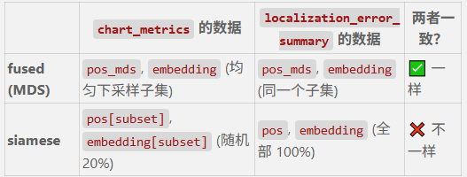

triplet-based 用cc_MIMO跑
步骤3：
```text
python run_adp_siamese.py 
  --data-path datasets/adp_old_shard4 
  --distance-run results/adp_old_fused/stride1_n20997_seed10 
  --stride 1 
  --out-dir results/adp_old_siamese
```
共享同一套 ADP/time 测地距离。它们对应 ADP 论文中的两条 charting 路径。

**共同前半部分**
两种方法都先计算：

```text
CSI
 -> ADP 相异度 D_ADP
 -> 与时间戳距离融合
 -> D_fused = min(D_ADP, gamma × D_time)
 -> kNN 图最短路径
 -> 测地距离 D_geodesic
```

区别在于：如何把测地距离转换为二维 chart。

| 方法 | 二维 chart 如何生成 | 是否训练神经网络 |
| --- | --- | --- |
| ADP/time fused MDS | 直接对测地距离矩阵做 MDS 降维 | 否 |
| ADP Siamese FCF | 训练网络，让网络输出的二维距离逼近测地距离 | 是 |

**ADP/time fused MDS**
对应代码 [run_adp_fused.py](D:/diffusion_refined_charting/run_adp_fused.py)。

可以理解为：

```text
D_geodesic -> MDS -> 二维坐标
```

MDS 是经典流形学习方法。它直接处理当前这批样本之间的距离矩阵。加入新 CSI 样本时，通常需要额外设计样本外映射或重新计算。

**ADP Siamese FCF**
对应代码 [run_adp_siamese.py](D:/diffusion_refined_charting/run_adp_siamese.py)。

可以理解为：

```text
CSI -> 神经网络 f(CSI) -> 二维坐标
```

训练时，步骤2产生的 `D_geodesic` 是监督信号：

```text
||f(CSI_i) - f(CSI_j)|| ≈ D_geodesic(i, j)
```

它不使用真实位置训练，所以仍然属于自监督方法。FCF 是 Forward Charting Function。

**两者在 ADP 论文中的关系**
ADP 论文的核心贡献首先是 ADP + 时间戳融合的相异度设计。这个相异度可以用于不同的 charting 算法：

1. 用测地距离加 MDS / Isomap 风格降维，得到传统 chart。
2. 用测地距离训练 Siamese FCF，得到神经网络 chart。

因此：
- `ADP/time fused MDS` 是经典非参数基线。
- `ADP Siamese FCF` 是论文中的神经网络版本。
- 导师的新方法是在第二种方法的输出上继续做图扩散精修。

整体链路是：

```text
ADP/time 测地距离
 ├── MDS -> ADP/time fused MDS 基线
 └── Siamese FCF -> ADP Siamese FCF 基线
                   └── 图扩散精修 -> 导师的新方法
```


**物理图vs欧氏图消融**

“物理图 vs 欧氏图”：**图扩散精修里用于构造拉普拉斯图 `L` 的邻接关系从哪里来**。

**1. ADP/物理测地图是什么**

ADP/物理测地图指的是用 CSI 推出来的物理相似性图，不用真实 UE 坐标。

具体来源是：

1. `run_adp_fused.py` 先从 CSI 算 ADP dissimilarity。
2. 再融合时间戳距离：
   `D_fused(i,j) = min(D_ADP(i,j), gamma * |t_i - t_j|)`
3. 然后在这个 fused 距离上建 kNN 图，跑 shortest path，得到 geodesic distance。
4. 输出到：

```text
results/adp_old_fused/stride1_n20997_seed10/geodesic.npy
```

这就是后续精修用的“物理测地距离”。

对应代码主要在：

[run_adp_fused.py](/d:/diffusion_refined_charting/run_adp_fused.py)  
[run_diffusion_refined_charting.py](/d:/diffusion_refined_charting/run_diffusion_refined_charting.py)

在 `run_diffusion_refined_charting.py` 里，它读取：

```python
distances = np.load(args.distance_run / "geodesic.npy").astype(np.float32)
```

然后用这个距离矩阵找邻居、构图、做图拉普拉斯平滑。

**2. 对应哪个结果**

物理图精修结果是：

```text
results/diffusion_refined_charting/stride1_n20997_k128_lambda0.15_seed10/result.json
```

结果大约是：

```text
CT   = 0.9982
TW   = 0.9982
KS   = 0.0651
mean = 0.3187 m
P95  = 0.6346 m
max  = 1.1414 m
```

这是 README 里“图扩散精修”的主结果。

**3. 换成欧氏图是什么意思**

“换成欧氏图”不是换初始 embedding，也不是换求解器，而是只换构图依据。

原来的物理图：

```text
CSI -> ADP/time fused distance -> geodesic.npy -> kNN graph -> Laplacian L
```

欧氏图消融：

```text
Siamese 初始 embedding Y0 -> 普通二维欧氏距离 -> kNN graph -> Laplacian L
```

也就是说，把“用信道物理距离建图”改成“直接在初始二维 chart 上按欧氏距离找邻居建图”。

然后仍然解同一个问题：

```text
(I + lambda L) Z = Y0
```

这样可以检验：提升到底来自“图拉普拉斯平滑本身”，还是来自“ADP/time 物理图确实更对”。

**4. 为什么这是决定性消融**

如果欧氏图也很好，说明方法可能只是普通 smoothing。  
如果物理图明显更好，说明关键贡献是：**用 CSI/ADP/time 构造的物理测地图更准确地刻画了 UE 流形**。

目前结果就是后者：

```text
Siamese baseline:
mean 0.4093 m, P95 0.8558 m, max 7.8936 m

欧氏图精修:
mean 0.3944 m, P95 0.7645 m, max 8.4133 m

物理图精修:
mean 0.3187 m, P95 0.6346 m, max 1.1414 m
```

欧氏图只带来轻微平均误差改善，尾部甚至更差；物理图则显著压低 P95 和最大误差。

**文献清单**
1. **Channel Charting: Locating Users within the Radio Environment using CSI**, 2018, [arXiv:1807.05247](https://arxiv.org/abs/1807.05247)。经典 CC 定义：从 CSI 提取大尺度衰落特征，用降维/流形学习/DNN 学 pseudo-position，强调局部几何保持与无监督定位。([arxiv.org](https://arxiv.org/abs/1807.05247))

2. **Siamese Neural Networks for Wireless Positioning and Channel Charting**, 2019, [arXiv:1909.13355](https://arxiv.org/abs/1909.13355)。把监督定位、无监督 CC、半监督定位统一到 Siamese 网络；这是“Siamese FCF chart”的直接经典背景。([arxiv.org](https://arxiv.org/abs/1909.13355))

3. **Triplet-Based Wireless Channel Charting: Architecture and Experiments**, 2020/2021, [arXiv:2005.12242](https://arxiv.org/abs/2005.12242)。用时间邻近构造 triplet，自监督学习 CSI 相似度和低维 chart，并在商用 Massive MIMO 数据上验证。([arxiv.org](https://arxiv.org/abs/2005.12242))

4. **Indoor Localization with Robust Global Channel Charting: A Time-Distance-Based Approach**, 2022, [arXiv:2210.06294](https://arxiv.org/abs/2210.06294)。提出 time-distance metric，使 CSI 距离接近真实欧氏距离；用 Siamese 网络近似该 metric，UWB/5G 实测达到 0.69 m/1.4 m。([arxiv.org](https://arxiv.org/abs/2210.06294))

5. **Angle-Delay Profile-Based and Timestamp-Aided Dissimilarity Metrics for Channel Charting**, 2023, [arXiv:2308.09539](https://arxiv.org/abs/2308.09539)。核心相关：ADP 距离、deep metric、timestamp 与 CSI dissimilarity 融合，在 sub-6GHz distributed massive MIMO 实测数据上优于旧 metric。([arxiv.org](https://arxiv.org/abs/2308.09539))

6. **Augmenting Channel Charting with Classical Wireless Source Localization Techniques**, 2023, [arXiv:2312.01968](https://arxiv.org/abs/2312.01968)。指出 CC 局部邻域好但全局几何弱；把 triangulation/multilateration 信息用于训练后映射或 FCF 训练中的 augmented CC。([arxiv.org](https://arxiv.org/abs/2312.01968))

7. **Channel Charting in Real-World Coordinates with Distributed MIMO**, 2024/2025 rev., [arXiv:2406.13722](https://arxiv.org/abs/2406.13722)。D-MIMO 实坐标化：用 AP 已知位置构造 bilateration loss 和 LoS bounding-box loss，不用 UE 真值坐标。([arxiv.org](https://arxiv.org/abs/2406.13722))

8. **Global Scale Self-Supervised Channel Charting with Sensor Fusion**, 2024, [arXiv:2405.04357](https://arxiv.org/abs/2405.04357)。用 TRP ToA、TRP 位置和 laser scanner 融合，仍声称训练/测试自监督；仿真中 90% sub-meter。([arxiv.org](https://arxiv.org/abs/2405.04357))

9. **Uncertainty-Aware Dimensionality Reduction for Channel Charting with Geodesic Loss**, 2024, [arXiv:2412.01715](https://arxiv.org/abs/2412.01715)。处理非凸几何中欧氏距离与 geodesic distance 不一致；把 dissimilarity 建模为概率分布，并可纳入运动惯性约束。([arxiv.org](https://arxiv.org/abs/2412.01715))

10. **Channel Charting-Based Channel Prediction on Real-World Distributed Massive MIMO CSI**, 2024, [arXiv:2410.11486](https://arxiv.org/abs/2410.11486)。用 chart 中空间关系和惯性预测未来 CSI，在真实 distributed massive MIMO 数据上比较 Wiener/outdated CSI。([arxiv.org](https://arxiv.org/abs/2410.11486))

11. **TDoA-Based Self-Supervised Channel Charting with NLoS Mitigation**, 2025/2026 rev., [arXiv:2510.08001](https://arxiv.org/abs/2510.08001)。用 CIR+TDoA+TRP 位置构造全球尺度自监督定位函数，并加入短时 UE displacement 与 NLoS mask；真实 5G/O-RAN 测试床，90% 误差约 2-4 m。([arxiv.org](https://arxiv.org/abs/2510.08001))

12. **Manifold Regularization: A Geometric Framework for Learning from Labeled and Unlabeled Examples**, 2006, [JMLR](https://www.jmlr.org/papers/v7/belkin06a.html)。经典 Laplacian/manifold regularization：用边际分布几何约束函数平滑，图正则和标准 RLS/SVM 都可视为特例。([jmlr.org](https://www.jmlr.org/papers/v7/belkin06a.html))

**对你的方案的新颖性判断**
“用 ADP/time 物理图构造 Laplacian，对 Siamese FCF chart 做 `(I + lambda L) Z = Y0` 精修”整体是**有工程价值但新颖性偏中等/增量**。

证据链很清楚：Siamese/FCF 已有；time/triplet 已有；ADP+timestamp metric 已有；D-MIMO 实坐标/物理约束已有；Laplacian/manifold regularization 是经典方法。因此，单独的“Laplacian 平滑后处理”不够强。可能的新颖点应收窄为：**把 ADP/time 构成的物理可信图作为 chart-domain post-hoc refinement，用闭式图 Tikhonov/implicit diffusion 修正已训练 Siamese FCF 的输出，并系统验证它在真实 D-MIMO 或 time-distance 数据上的稳定增益**。

主要风险：
- **过平滑**：`lambda` 大会压缩轨迹细节，尤其交叉路径、停顿、NLoS 跳变、楼层/遮挡边界。
- **图构造泄漏**：如果 time 边隐含轨迹顺序，测试集 transductive 图会用到测试样本间关系；论文里必须明确是 transductive refinement 还是 inductive deployment。
- **全局几何未必改善**：Laplacian 平滑主要降低高频噪声，不自动恢复旋转、尺度、弯曲和翻折；要和 Procrustes/affine alignment 后指标分开评估。
- **与已有 ADP/timestamp metric 融合太近**：第 5 篇已经做 ADP+timestamp dissimilarity，用于 manifold learning；你的差异要强调“训练后图隐式扩散精修 FCF 输出”，而不是只说“用了 ADP/time”。
- **无 out-of-sample 解**：闭式 `Z` 是样本级 refinement；新 UE 来了需要局部图插值、Nystr?m、或把 refined `Z` distill 回 FCF。

**可继续推进的研究 idea**
1. **Ablation：图来源与 λ 扫描**
   比较 `ADP-only graph`、`time-only graph`、`ADP+time product/sum graph`、`CSI kNN graph`、`random graph`。指标用 trustworthiness/continuity、KNN position error、TW/CT、Procrustes RMSE。报告 λ 从 0 到强平滑的曲线，证明不是简单低通带来的偶然收益。

2. **边可靠性加权的 Laplacian**
   给边权加置信度：`w_ij = exp(-d_ADP/sigma_a) * exp(-dt/sigma_t) * q_ij`，其中 `q_ij` 来自 LoS/NLoS 判别、ADP 峰锐度、SNR、TDoA 残差或 triplet consistency。实验比较普通 Laplacian 与 confidence Laplacian，重点看 NLoS 区域是否少过平滑。

3. **局部各向异性/鲁棒正则**
   把二次项 `Tr(Z^T L Z)` 改为 Huber/TV 图正则，或按时间方向和 ADP 邻域方向用两个 Laplacian：`||Z-Y0||^2 + λa Z^T La Z + λt Z^T Lt Z`。实验看交叉轨迹、拐角、遮挡边界是否比普通 Laplacian 保边。

4. **Transductive-to-inductive distillation**
   先用闭式解得到 `Z*`，再用 `Z*` 作为 teacher 微调 FCF：`f_theta(x_i) -> Z*_i`，并在 held-out trajectories 上测试。这样能解决部署时没有全量测试图的问题，也能把“后处理”升级为可部署算法。

5. **与 geodesic/augmented CC 对照**
   在非凸路径或多房间数据上，比较你的 Laplacian refinement、geodesic loss、augmented CC、time-distance Siamese。重点证明：你的方法在不改训练、不用 AP 坐标或少用坐标时，能以最低成本接近这些训练内方法。