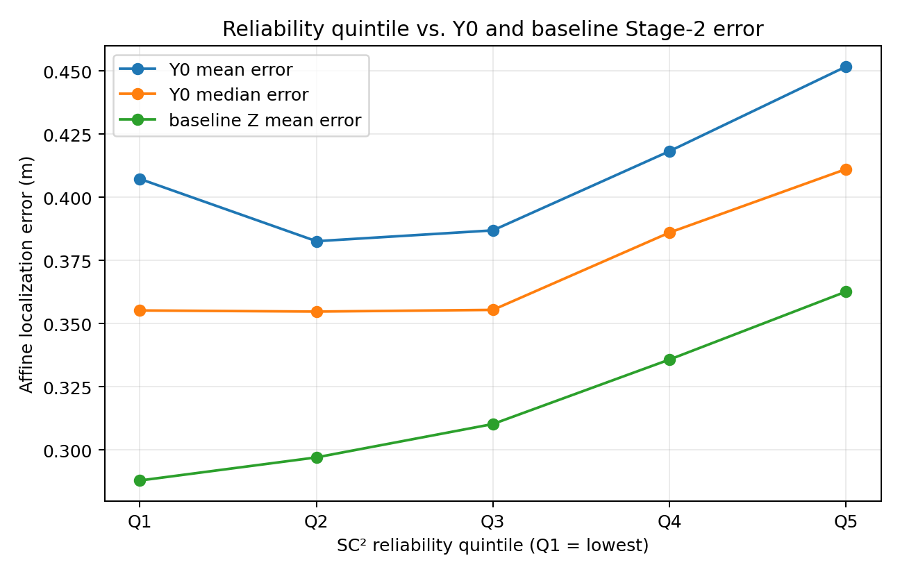
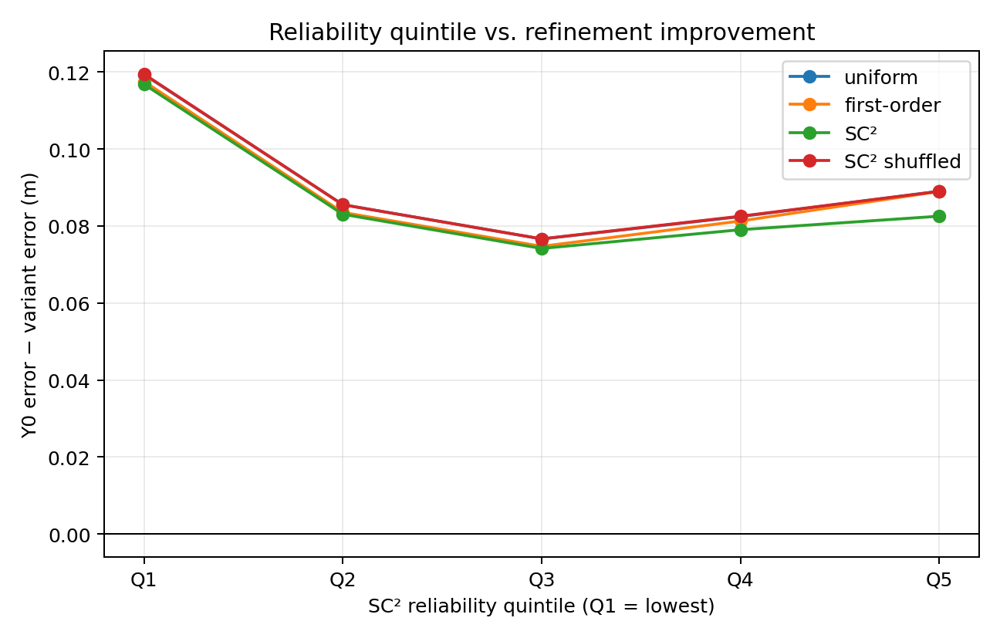
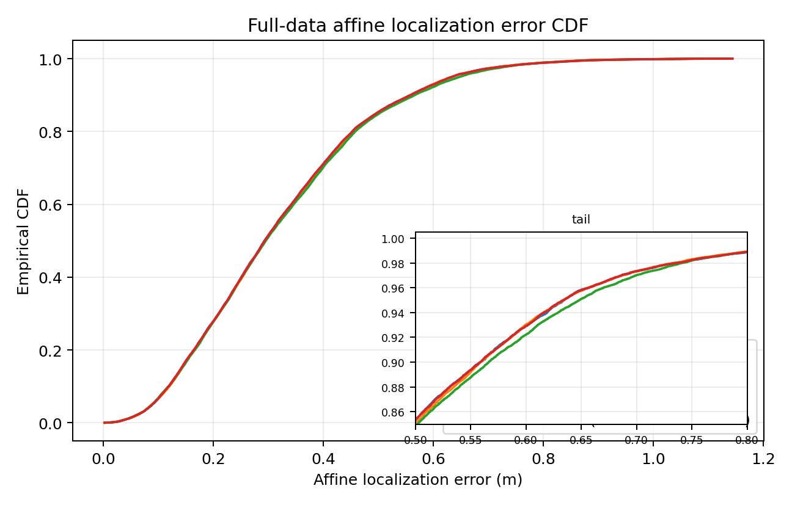

# SC²-inspired Stage-2 adaptive-fidelity pilot

## Scope and frozen configuration

This pilot estimates per-sample reliability from the original geodesic local neighborhoods and original Siamese `Y0`. It changes only the fidelity coefficient in the existing Stage-2 Jacobi update. Stage-1 graph construction, fused distances, `D_geo`, Siamese training, Stage-2 graph weights, and MDS gates were not changed or recomputed.

- Samples: `20997`; seed: `10`.
- Local reliability neighbors: top-`64` directed neighbors from the original `D_geo`.
- Stage-2 graph: top-`128` from the existing top-`512` cache; `lambda=0.15`, `200` Jacobi iterations; graph edges `3088334`.
- Evaluation subset: the same `4199` samples selected by `random.seed(10); random.sample(range(N), int(N*0.2))`; affine localization summaries use all samples.
- Ground truth positions appear only in evaluation and plots.

## Input provenance

- code: `methods/sc2_stage2/run_sc2_adaptive_fidelity.py`
- approved plan: `docs/tasks/sc2_stage2_adaptive_fidelity_pilot.md`
- exact command: `D:\anaconda3\envs\diffusion_charting\python.exe methods\sc2_stage2\run_sc2_adaptive_fidelity.py --data-path D:\diffusion_refined_charting\datasets\adp_old_shard4 --distance-run D:\diffusion_refined_charting\results\adp_old_fused\stride1_n20997_seed10 --init-embedding D:\diffusion_refined_charting\results\adp_old_siamese\stride1_n20997_seed10\embedding.npz --baseline-embedding D:\diffusion_refined_charting\results\diffusion_refined_charting\stride1_n20997_k128_lambda0.15_seed10\embedding.npz --out-dir results\sc2_stage2_adaptive_fidelity_pilot --device cuda:0`

- `data_path`: `D:\diffusion_refined_charting\datasets\adp_old_shard4`
- `ue_pos`: `D:\diffusion_refined_charting\datasets\adp_old_shard4\UE_pos.npy`
- `distance_run`: `D:\diffusion_refined_charting\results\adp_old_fused\stride1_n20997_seed10`
- `geodesic`: `D:\diffusion_refined_charting\results\adp_old_fused\stride1_n20997_seed10\geodesic.npy`
- `neighbor_cache`: `D:\diffusion_refined_charting\results\adp_old_fused\stride1_n20997_seed10\geodesic_top512.npy`
- `y0`: `D:\diffusion_refined_charting\results\adp_old_siamese\stride1_n20997_seed10\embedding.npz`
- `baseline_z`: `D:\diffusion_refined_charting\results\diffusion_refined_charting\stride1_n20997_k128_lambda0.15_seed10\embedding.npz`

The existing top-512 cache was read-only validated on the sampled rows recorded in `pilot_metrics.json`; every sampled first-64 prefix satisfied the raw-D_geo rank condition. `3` sampled top-64 rows and `1` top-512 row had boundary ties, so exact index sets are not always unique; no cache was regenerated or written to the original distance directory.

## Reliability construction

For each directed top-64 pair, `dY=||Y0_i-Y0_j||` and the robust log scale was `median(log(dY)-log(D_geo)) = -0.177210449`. The resulting residual median was `0.431074778`, and `tau=median(residual)+epsilon` was `0.431074778` with `epsilon=1e-12`.

`C_directed` is converted to a symmetric sparse matrix with `C = C_directed.maximum(C_directed.T)`. This preserves unilateral top-64 edges without halving them through sparse zeros. The FO mean uses the original directed top-64 neighbors. SC² computes the cosine-style common-neighbor consistency `H` from the symmetric sparse rows, then averages `S=C_ij H_ij` over those same directed top-64 neighbors.

A focused sparse-overlap regression checked `40` local product entries against direct sparse row intersections; bad entries: `0`, maximum absolute difference: `7.11e-15`. The initial implementation run was invalidated because unsorted CSR product indices made `searchsorted` extraction incorrect; product indices were sorted, this check passed, and the complete pilot was recomputed. That correction is implementation repair within this pilot, not a separate experimental condition.

The directed compatibility graph has `1343808` edges and the symmetric union has `1544020` edges. Reliability arrays are saved as [`first_order_reliability.npy`](first_order_reliability.npy) and [`sc2_reliability.npy`](sc2_reliability.npy).

## Diagnostic: reliability and existing refinement

Quintiles are sorted from low to high SC² reliability. Because `N` is not divisible by five, the group sizes differ by one sample.

| Group | N | mean q_SC2 | Y0 mean (m) | Y0 median (m) | baseline Z mean (m) | Y0 − Z mean (m) |
|---|---:|---:|---:|---:|---:|---:|
| Q1 | 4200 | 0.074661 | 0.407278 | 0.355224 | 0.287940 | 0.119338 |
| Q2 | 4200 | 0.099873 | 0.382629 | 0.354781 | 0.297082 | 0.085547 |
| Q3 | 4199 | 0.118367 | 0.386908 | 0.355451 | 0.310281 | 0.076627 |
| Q4 | 4199 | 0.141407 | 0.418232 | 0.386033 | 0.335790 | 0.082441 |
| Q5 | 4199 | 0.201918 | 0.451696 | 0.411136 | 0.362658 | 0.089038 |

| Reliability | Spearman rho with Y0 error | p value | Spearman rho with Y0 − baseline Z error | p value |
|---|---:|---:|---:|---:|
| SC² | 0.081392 | 3.35e-32 | -0.011574 | 0.0935 |
| first-order | -0.030812 | 7.98e-06 | -0.057270 | 9.99e-17 |

## Four fidelity variants

All variants use the same inherited Stage-2 graph and the update `Z_i=(a_iY_i+lambda sum_j W_ij Z_j)/(a_i+lambda d_i)`. Percentiles use the full-data average rank with `p_i=(rank_i-0.5)/N`; `sc2_shuffled` applies a fixed seed-10 permutation to the SC² fidelity vector, preserving its exact distribution.

| Variant | CT | TW | KS | affine mean (m) | median (m) | P90 (m) | P95 (m) | max (m) |
|---|---:|---:|---:|---:|---:|---:|---:|---:|
| uniform | 0.998219596 | 0.998222527 | 0.065064572 | 0.318748 | 0.292916 | 0.558675 | 0.634640 | 1.141431 |
| first-order | 0.998219433 | 0.998214786 | 0.064944254 | 0.320131 | 0.294484 | 0.558671 | 0.634042 | 1.137300 |
| SC² | 0.998215810 | 0.998226793 | 0.064834721 | 0.322221 | 0.295216 | 0.566262 | 0.648272 | 1.139827 |
| SC² shuffled | 0.998220782 | 0.998221842 | 0.064948430 | 0.318709 | 0.293184 | 0.558635 | 0.633944 | 1.144125 |

### Uniform reproduction check

The uniform variant was compared against the supplied original baseline embedding before reporting variants. The new uniform-vs-saved comparison was max/mean/RMSE `0.000305175781` / `1.88918173e-05` / `3.07029663e-05`. The tracked solver-vs-saved comparison was max/mean/RMSE `0.000274658203` / `1.91196372e-05` / `3.08127083e-05`; repeated uniform-vs-saved max was `0.000274658203` and new uniform-vs-repeat max was `0.000244140625`. These differences are CUDA `index_add_` accumulation variation at the same scale as run-to-run variation; the documented implementation tolerance is max absolute coordinate difference `<= 0.0005`. Shared-subset metrics agree at the displayed precision.

At this fixed configuration, SC² has affine mean `0.322221 m` versus uniform `0.318748 m` (change `+0.003473 m`) and P95 `0.648272 m` versus `0.634640 m` (change `+0.013633 m`). The shuffled control has mean `0.318709 m`; first-order changes the mean by `+0.001383 m`. SC² reliability has Spearman rho `+0.081392` with Y0 error, so the observed ordering places higher SC² scores with higher Y0 error in this pilot. Its rho with pointwise Y0 minus baseline-Z improvement is `-0.011574` (p=`0.0935`), and the quintile means are nonmonotone for improvement. The fixed SC² fidelity rule therefore does not improve the Stage-2 baseline here and is not supported as a useful repair selector by this pilot, despite small KS/TW differences.

## Interpretation and limits

The diagnostic reports whether the reliability signal tracks existing Y0 error and whether it tracks the amount repaired by the fixed baseline. The four-way comparison separates a reliability-conditioned fidelity rule from a graph-only effect and from a shuffled assignment with the same fidelity distribution. These observations are a transductive pilot at one frozen seed and one fixed Stage-2 graph; they do not establish unseen-CSI deployment, Stage-1 causality, or publication novelty.

Machine-readable metrics and exact input paths are in [`pilot_metrics.json`](pilot_metrics.json). Variant embeddings and fidelity vectors are in [`variant_embeddings.npz`](variant_embeddings.npz) and [`fidelity_vectors.npz`](fidelity_vectors.npz).
