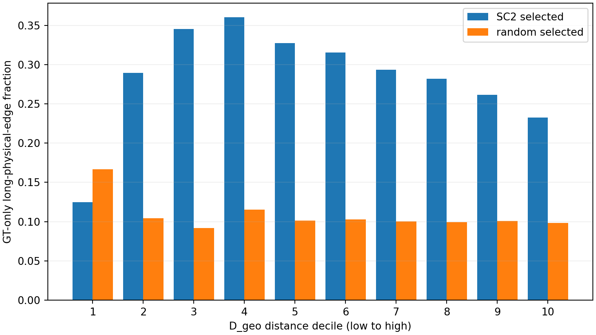
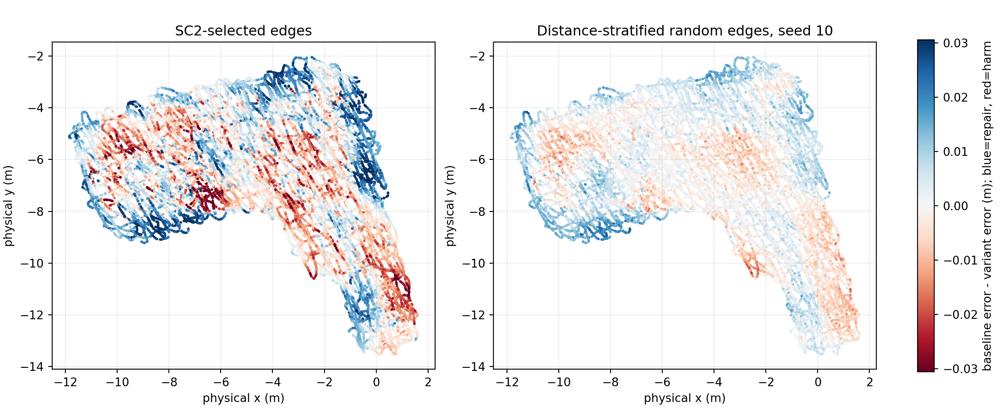
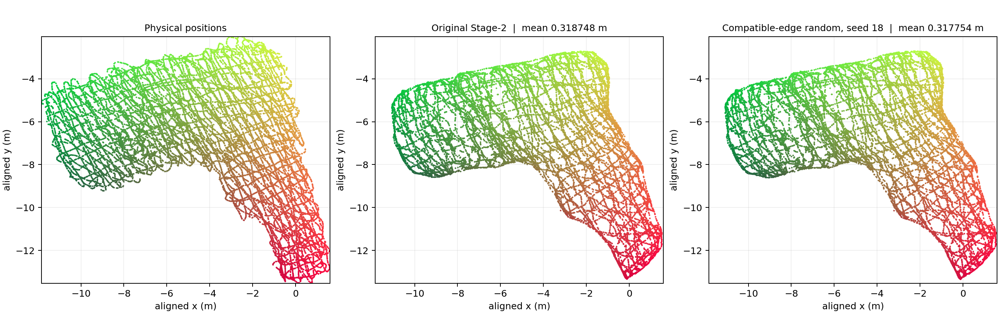

# SC² 启发的 Stage-2 边级精修实验报告

## 结论

在原始 Stage-2 图中，把约 11 万条边的权重减半，能让这张 Channel Chart 的误差小幅下降。但**按本次 SC² 共同支持分数定向选边，没有优于距离分层随机选边**：SC² 方案的平均误差从原图的 0.318748 m 降至 0.318021 m，P95 却由 0.634640 m 升至 0.636267 m；在一阶兼容边中随机选边的 20 次运行，平均误差中位数为 0.317755 m，P95 中位数为 0.633537 m。二阶分数能够富集物理跨度偏大的边，但“选中了这类边”和“减弱它们能改善最终图谱”是两回事。

这是单张图谱、全样本建图的 **transductive** 结果。20 个随机 seed 只改变选边掩码，不是 20 套独立数据；目前不能宣称新 CSI 或新环境的泛化收益，也不能把随机降权的改善归功于 SC²。

## 1 实验问题与固定条件

问题是：从已有 Stage-2 图中挑出缺乏共同支持的边并减弱它们，是否能比原图、一阶选边和随机选边得到更好的精修图谱？这里借鉴 [SC²-PCR 论文](https://arxiv.org/html/2203.14453)及[作者代码](https://github.com/ZhiChen902/SC2-PCR)的“共同兼容关系”思想；把分数用于 Stage-2 图边权是本实验设计，**不是原论文的点云配准算法复现**。

| 固定项 | 本次设置 |
|---|---|
| 数据与样本 | DICHASUS cf02/cf03/cf04，stride=1，N=20,997，无 held-out CSI 划分 |
| 输入 | 原始 `D_geo`、原始 Siamese `Y0`；Stage-1 的 k=20 图及训练不改 |
| Stage-2 原图 | 同一份局部尺度 `W`，`graph_k=128`，1,544,167 条无向边 |
| 求解 | `lambda=0.15`，从 `Y0` 开始做 200 次 Jacobi；节点 fidelity 始终为 1 |
| 评价 | CT/TW/KS 使用同一组 seed-10 抽出的 4,199 个样本；仿射对齐误差使用全部 20,997 个样本 |
| GT 边界 | 真实 UE 位置只用于离线评价、事后诊断和展示案例；不参与分数、选边或调参 |

原图求解在本环境重跑，与保存的原 Stage-2 图谱最大坐标差为 0.000366211 chart 单位；这是已记录的 CUDA `index_add_` 累加顺序差异，评价指标与保存结果一致。完整配置见 [config.json](config.json)，代码入口见 [run.py](../../methods/sc2_stage2_edge_consensus/run.py)。

## 2 分数怎样算，哪些边被改了

对原始 `D_geo` 的每个有向 top-128 邻居对 `(i,j)`，计算 `dY_ij=||Y0_i-Y0_j||`。先用所有这些对的中位数估计全局对数尺度 `log_s=median(log(dY)-log(D_geo))`，再计算距离不一致程度 `r_ij=|log(dY_ij)-log(D_geo_ij)-log_s|`。当 `r_ij ≤ median(r)+MAD(r)=0.626941` 时，把该关系记为一阶兼容 `B_ij=1`；将有向关系作对称并集后，计算边的二阶共同支持数：

`T_ij = B_ij × Σ_k B_ik B_kj`。

原 Stage-2 图的 1,544,167 条无向边中，1,108,622 条为 `B=1`。本次在这些边中按 `T` 从低到高选出 110,862 条（原图边数的 7.18%；同分时固定 seed=10 打破并列），把其原权重乘 0.5。**没有删除边，也没有修改节点 fidelity。**

主要对照为：原图 `W`；在同一 `B=1` 范围内按一阶残差选边；在相同十个 `D_geo` 距离层各随机选同样数量的兼容边；把全部图权统一缩放到与 SC² 方案相同的总权重。看到首个随机对照后，按后续固定方案扩展到 seed 10–29，并补充从所有边和一阶不兼容边随机选的对照。所有随机对照的选边数、分层和乘数保持一致，不使用 GT。

**“距离分层随机”的确切含义：**先记录 SC² 在十个 `D_geo` 距离层分别选了多少边，再在指定候选池的每一层随机抽相同数量。十层计数为 `24, 701, 2625, 5285, 8611, 12424, 16645, 18643, 21813, 24091`；最长四层占所选边的 **73.2%**。因此，随机对照也主要减弱较长的 `D_geo` 边。现有结果不能把它的收益单独归因于“随机”，也没有分开检验距离层配额本身的作用。

## 3 完整结果

CT/TW 越高越好，KS 和误差越低越好。标有“20 次中位数”的行把**每个指标分别**对 20 次固定掩码取中位数，因此该行不对应某一张实际 Channel Chart；其余行是单次运行。每个 seed 的完整指标及最小/最大值见 [complete_metrics_followup.json](complete_metrics_followup.json)。

| 方法 | CT ↑ | TW ↑ | KS ↓ | 平均误差 m ↓ | 中位数 m ↓ | P90 m ↓ | P95 m ↓ | 最大误差 m ↓ |
|---|---:|---:|---:|---:|---:|---:|---:|---:|
| 原图，λ=0.15 | 0.998220 | 0.998223 | 0.065065 | 0.318748 | 0.292917 | 0.558674 | 0.634640 | 1.141431 |
| SC² 低支持选边，λ=0.15 | 0.998215 | 0.998226 | 0.064982 | 0.318021 | 0.293037 | 0.558251 | 0.636267 | 1.128056 |
| 一阶残差选边，λ=0.15 | 0.998216 | 0.998224 | 0.064990 | 0.318652 | 0.293098 | 0.558974 | 0.635685 | 1.135260 |
| 全图等比例减权，λ=0.15 | 0.998221 | 0.998225 | 0.065015 | 0.318606 | 0.292580 | 0.559256 | 0.634479 | 1.138186 |
| 兼容边随机，λ=0.15，20 次中位数 | 0.998224 | 0.998232 | 0.064876 | **0.317755** | **0.291713** | **0.557865** | **0.633537** | 1.135059 |
| 所有边随机，λ=0.15，20 次中位数 | 0.998226 | 0.998233 | 0.064887 | 0.317847 | 0.291831 | 0.557988 | 0.633682 | 1.135528 |
| 不兼容边随机，λ=0.15，20 次中位数 | 0.998230 | 0.998232 | 0.064929 | 0.318247 | 0.292145 | 0.558305 | 0.633871 | 1.138161 |
| 原图，λ=0.1344，已有最优均值对照 | 0.998223 | 0.998232 | 0.064922 | 0.318396 | 0.292453 | 0.559025 | 0.637179 | 1.128971 |
| 兼容边随机，λ=0.1344，20 次中位数 | 0.998226 | 0.998241 | 0.064804 | **0.317687** | **0.291537** | 0.559515 | 0.637157 | **1.123354** |

在原 `lambda=0.15` 下，兼容边随机和所有边随机各自 **20/20 次**都在 CT、TW、KS、平均误差、中位数、P90、P95、最大误差八项上优于原图；20 次兼容边随机的平均误差范围为 0.317688–0.317833 m。SC² 定向选边虽把均值改善约 **0.73 毫米**，却使中位数和 P95 变差，且 20 次兼容边随机的均值全部低于它。全图等比例减权的均值为 0.318606 m，也没有达到分层随机选边的结果；但这仍不能分开证明“候选池限制”“距离层配额”和“局部降权”各自贡献多少。

已有原图 `lambda=0.1344` 的均值为 0.318396 m。同一批兼容边随机掩码在这个 `lambda` 下 20/20 次降低均值，中位数为 0.317687 m；但 P90 20/20 次变差，P95 只有 12/20 次优于该原图。它是使用同一数据的**事后交叉检查**，不是新测试集或重新搜索 `lambda`。

## 4 为什么评分识别了异常边，最终却没赢随机

### 边的事后检查

SC² 与 seed-10 随机对照各调整 110,862 条边，在十个 `D_geo` 距离层的数量完全相同。所选边的 `D_geo` 中位数都约为 41.4，原权重中位数分别为 0.401 与 0.409；共同支持数中位数分别为 11 与 27。

只在选边规则已固定后，用 GT 作如下诊断：在每个 `D_geo` 层的兼容边中，把物理端点距离最长的 10% 标记为“跨度偏大”。SC² 选中边中 **28.1%** 落入这一组，随机选中边为 **10.1%**；物理端点距离中位数分别为 0.582 m 与 0.442 m。下图横轴从较短到较长的十个 `D_geo` 层，纵轴是各方法选中边里“跨度偏大”的比例；除最短一层外，蓝柱均明显高于橙柱，说明该分数确实偏向这类边。但“跨度偏大”只是事后代理标签，**不能证明减弱该边有利于最终定位**。逐边案例见 [posthoc_edge_and_sample_audit.json](posthoc_edge_and_sample_audit.json)。

### 点的修复与损害

每种图谱都按原评价代码**单独做全样本 affine 对齐**，再与 GT 计算逐点误差。相对原图，SC² 方案修好 10,527 个点、伤到 10,470 个点；修复与损害的误差总量分别为 128.04 m、112.77 m。seed-10 兼容边随机方案修好 11,181 个、伤到 9,816 个点，对应总量为 64.88 m、43.83 m。SC² 带来的正负改动都更大，随机降权的改动较温和，净收益反而更高。

同样数量的边，SC² 掩码只触及 19,582 个样本附近，seed-10 随机掩码触及 20,898 个；被选中边数最多的 10% 样本承接了 SC² 所选边端点的 28.1%，随机方案为 18.0%。每点被选中边数的 P95 分别为 28 和 18。下图把两个方案相对原图的逐点误差变化画在**真实物理位置**上：蓝色表示误差降低，红色表示误差升高。SC² 的蓝红变化更成片、更剧烈，说明其收益与损害都更集中；随机方案变化较小、分布较散。**“集中降权造成连带损害”只是解释线索，尚未有单边因果证据。**

### 完整 Channel Chart 长什么样

下图左侧是真实位置，中间是原 Stage-2 图，右侧是兼容边随机 seed-18 的图。两张结果图分别按同一评价方法做 affine 对齐，使用相同坐标范围和颜色；它们的整体轮廓几乎重合。**这张图用于查看是否出现明显形变，不能靠肉眼判断约 1 毫米的平均误差差别**；数值结论以上表为准。seed-18 只是展示例子，不代表上表的“20 次中位数”图谱。

具体例子：样本 8876 位于约 `(-10.99,-6.71) m`，在完整 SC² 掩码下误差从 0.1501 降到 0.0799 m，周围有 24 条被降权边；样本 8337 位于约 `(-9.51,-5.74) m`，误差却从 0.2479 升到 0.3111 m，周围有 30 条被降权边。展示用边 3183–14204 的共同支持数为 9、物理端点距离 2.398 m；边 14876–15269 的支持数为 11、距离 0.498 m。**这些案例是看完 GT 后挑来说明现象的**，完整实验同时改动十万余条边，而且独立 affine 对齐也会影响逐点差值，不能把某个样本的变化归因于展示的单条边。样本编号、位置、边分数和误差见[事后分析 JSON](posthoc_edge_and_sample_audit.json)及本地生成的逐点数组。

## 5 当前判断与下一步

本次固定方案没有满足“SC² 定向选边优于原图及所有对照”的判据。可以保留的观察是：**沿 SC² 距离层配额随机减弱边，在这一张 transductive 图谱上稳定得到小幅指标改善**；SC² 的共同支持分数在诊断中选中更多物理跨度大的边，却不是这次最好的降权排序。该收益究竟来自距离层配额、候选池限制，还是局部降权，尚未分开；在另一批 CSI 上能否保持也未验证。这里不能把本实验等同于原 SC²-PCR 的刚体配准流程。

当前最关键的问题是：**本次关系评分能识别某种异常，但没有证明“把它对应的边减半”是正确处理方式。** 本报告保留这个负结果和随机对照的真实边界，不据此继续调整分数方向或降权比例。若研究继续，应先用已有输入与逐点结果判断误差主要进入于原始无线关系、`D_geo`、`Y0` 还是最终精修，再决定在哪个环节处理，而不预设仍修改 Tikhonov 图权。原始 CSI `H.npy` 可按加载代码分成四组、每组八根天线；当前保存的 ADP 距离合并了视角，**尚无四组独立关系分数**。不同天线视角能否相互核验仍需单独检验。

## 代码与产物

- [固定方案及图构造代码](../../methods/sc2_stage2_edge_consensus/run.py)、[随机重复对照](../../methods/sc2_stage2_edge_consensus/random_followup.py)、[完整指标复核](../../methods/sc2_stage2_edge_consensus/complete_metrics.py)、[事后分析代码](../../diagnostics/sc2_edge_posthoc/audit.py)
- [精确配置](config.json)、[固定五组结果](result.json)、[四组各 20 次完整指标](complete_metrics_followup.json)、[逐边逐点事后明细](posthoc_edge_and_sample_audit.json)
- [代表性 seed-18 Channel Chart](channel_chart_seed18_vs_baseline.png)、[五组最终 embedding](embeddings.npz)、[seed-18 embedding](compatible_random_seed18_channel_chart.npz)
- 数据下载、放置与从原始 CSI 复现的命令见仓库 [README](../../README.md)。`edge_scores_and_masks.npz` 约 20 MB，由 `run.py` 在本地生成，未纳入仓库。
